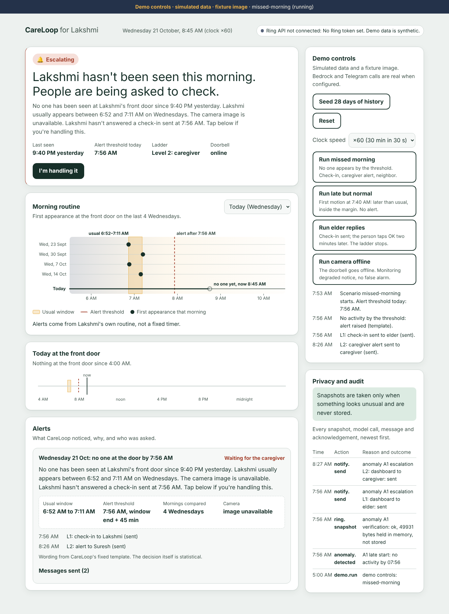
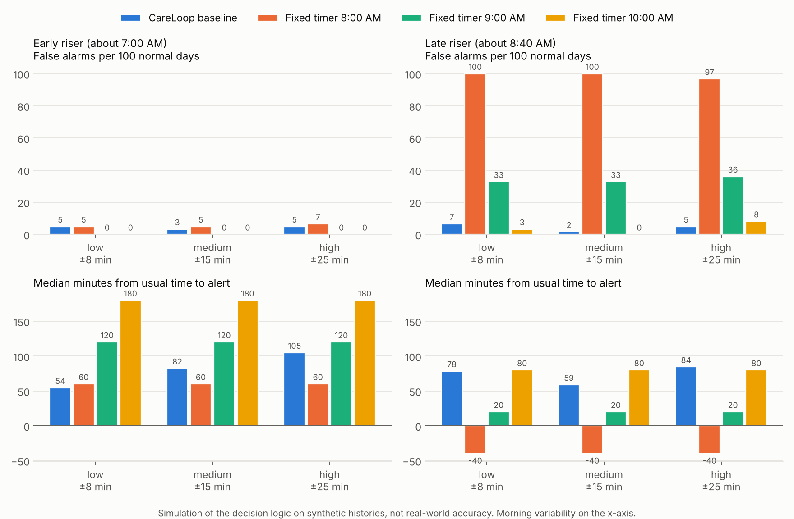
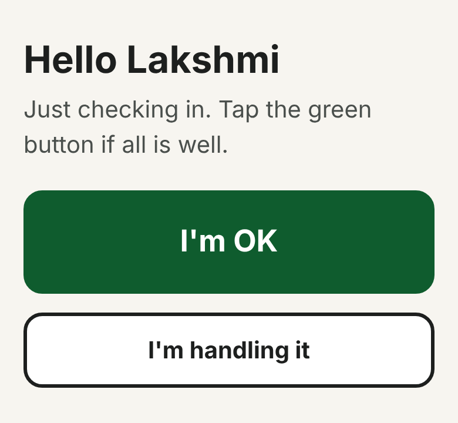
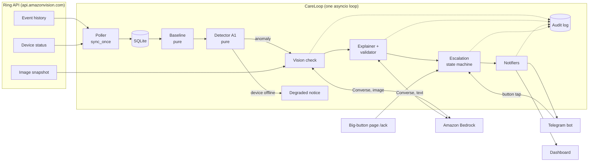

# CareLoop

**CareLoop notices when an older adult who lives alone misses their usual morning, using a Ring doorbell.** It learns the person's own routine (when they first appear at the front door, weekday by weekday), and if a morning passes the usual time by a clear margin, it checks one camera snapshot with an Amazon Bedrock vision model, explains in plain words why the morning looks unusual, and asks people in order: the person first, then family, then a neighbor.

It also notices an unusually long quiet stretch later in the day (after the person was seen that morning), and alerts can be paused for days the person is away.

Statistics decide whether to alert. AI only describes the snapshot and phrases the message, and every model output is checked before anyone sees it, by CareLoop's own validator and optionally by an Amazon Bedrock Guardrail.



*Dashboard during the `missed-morning` demo. History is synthetic, the snapshot is a fixture image, and the people are fictional.*

Built for the Ring track. Priority categories: **caretaking** (a calm, step-by-step check on a parent who lives alone) and **accessibility** (a one-tap big-button page for people who don't use apps, and a dashboard designed for low-vision readers).

## How it differs from a fixed inactivity timer

| | Fixed inactivity timer | CareLoop |
|---|---|---|
| When it alerts | The same clock time for everyone | Per weekday, from the person's own history: usual window [p10, p90], alert at p90 + 45 min |
| Before alarming family | Nothing | One camera snapshot, described by a Bedrock vision model ("appears to show a milk packet on the mat") |
| What family receives | "No activity" | Why it's unusual, what the camera shows, and what has been tried, in at most 70 words |
| Who is asked | Usually family straight away | The person first (one tap), then caregiver, then neighbor; any ack stops the ladder |
| Dead camera | Looks like a missing person, or stays silent | "Monitoring degraded since 8:05 AM", sent to the caregiver once; no false alarm |
| Quiet afternoon | One fixed "no activity for N hours" rule | Compared with the person's own longest quiet stretches for that part of the day (8–12, 12–4, 4–8), plus 60 min |
| Travel and visits | Turn the system off and hope someone turns it back on | Away mode for a date range: no alerts, and those days are left out of the learned routine |

### Evaluation (simulation)

`python scripts/evaluate.py` replays 90-day synthetic histories for two people (an early riser around 7:00 and a late riser around 8:40) at three levels of morning variability, with naturally late mornings and 8 injected days of no activity. CareLoop runs through the production detector, using past days only. Worst case across all six settings:

| Method | Most false alarms in any setting | Slowest median delay |
|---|---|---|
| **CareLoop baseline** | **4 of 61 days (7%)** | 105 min |
| Fixed timer 8:00 AM | 61 of 61 days (100%) | 60 min |
| Fixed timer 9:00 AM | 22 of 61 days (36%) | 120 min |
| Fixed timer 10:00 AM | 5 of 61 days (8%) | 180 min |

**What this shows:** no single fixed time works for both people, and CareLoop needs no tuning. **What it doesn't show:** CareLoop is not always faster. For the early riser, a well-placed 8:00 timer is as quiet and quicker. This is a simulation that tests the logic, not real-world accuracy. Full tables, parameters and the chart are in [docs/evaluation.md](docs/evaluation.md).



## Run it (no Ring hardware needed)

Needs Python 3.11 or newer.

```bash
git clone <this repo> && cd careloop
make setup            # virtualenv, installs CareLoop + dev tools, creates .env from .env.example
make test             # 110 tests, no network
make demo             # open http://127.0.0.1:8000 and use the demo panel
```

In the demo panel: **Seed 28 days of history**, then **Run missed morning**. At ×60 the whole ladder runs in about 95 seconds. The other scenarios: **late but normal** (first motion at 7:40, no alert), **elder replies** (simulated tap on "I'm OK", the ladder stops), **camera offline** (degraded notice, no false alarm), **long silence** (seen at 7:05 and 9:30 AM, then nothing until the afternoon check), and **away day** (away mode on, no alert).

The same scenarios run in the terminal with `make demo-cli SCENARIO=missed-morning`.

Without AWS or Telegram settings, the demo still runs end to end: the camera line says "camera image unavailable", the message comes from the deterministic template, and messages appear on the dashboard only. To see the real thing:

1. **Bedrock:** set `AWS_REGION`, `BEDROCK_VISION_MODEL_ID` and `BEDROCK_TEXT_MODEL_ID` in `.env`, run `aws configure`, then `python scripts/check_bedrock.py` (it lists the models and inference profiles in your region and tells you what to fix) and `python scripts/try_explainer.py`. Optionally run `python scripts/create_guardrail.py` and add the two lines it prints to `.env`.
2. **Telegram:** create a bot with @BotFather, have the three people message it once, and set `TELEGRAM_BOT_TOKEN` and the three `TELEGRAM_CHAT_*` IDs.
3. **Ring:** paste a Playground token into `RING_ACCESS_TOKEN`. The dashboard's connection indicator then makes a live `GET /v1/users/me` call, and `make probe` saves scrubbed real responses to `fixtures/`.

The big-button page that the check-in links to:



## Architecture



- **Deterministic core.** `baseline/model.py` and `detection/detector.py` are pure functions with no I/O and no model calls; they are what the evaluation imports.
- **Adapter boundaries.** Ring HTTP only in `ring/`, Bedrock only in `ai/` and `vision/`, sending only in `notify/`. Every adapter has a 10-second timeout, one retry, and a fallback.
- **One clock.** All code reads `core.clock.now()`; demo mode speeds it up.

## AWS services used, and how

| Service | Call | What it does in CareLoop |
|---|---|---|
| Amazon Bedrock Runtime, **Converse API** (image + text) | `converse` with the snapshot as an image block and a fixed prompt | Describes what is visible at the doorway in at most 25 words, with no speculation about anyone's health. Called once per anomaly, never on a schedule. |
| Amazon Bedrock Runtime, **Converse API** (text) | `converse` with only the facts JSON and the scene description | Phrases the caregiver message. The output is used only if it passes the validator (70 words or fewer, block list, all key times present); otherwise the deterministic template is sent. |
| **Amazon Bedrock Guardrails** (optional) | `guardrailConfig` on the explainer's Converse call; `create_guardrail` and `create_guardrail_version` in `scripts/create_guardrail.py` | Denies the topic "medical diagnosis" and blocks alarming words in model output. If the guardrail intervenes, the deterministic template is sent and the audit log says so. CareLoop's local validator always runs too. |
| Amazon Bedrock (control plane) | `list_foundation_models`, `list_inference_profiles` | Used by `scripts/check_bedrock.py` to diagnose model access and test the guardrail. |

Model IDs come from `BEDROCK_VISION_MODEL_ID` and `BEDROCK_TEXT_MODEL_ID`; any Converse-compatible model (or inference profile ID) works. Calls use botocore with 10 s timeouts and one retry, and every call writes an audit row (action, reason, outcome with token counts, never content). In line with the Ring Computer Vision Guidelines, only one still frame is sent, inference runs in your own AWS account and region, model output is never treated as ground truth, and every output is checked against a block list with a defined fallback.

## Ring endpoints used

All calls are in [`backend/app/ring/client.py`](backend/app/ring/client.py) (server-to-server, `Authorization: Bearer <token>`).

| Endpoint | Used for |
|---|---|
| `GET /v1/users/me` | Connection indicator on the dashboard (live call) |
| `GET /v1/devices?include=status,capabilities` | Finding the doorbell |
| `GET /v1/devices/{id}/status` | Device health guard (online/offline) |
| `GET /v1/history/devices/{id}/events` | Activity history: human motion and doorbell presses |
| `POST /v1/devices/{id}/media/image/download` | One snapshot per anomaly, kept in memory only |

## Privacy and dignity

- The person is asked first, with one tap, before anyone else is contacted.
- Snapshots are taken only when an anomaly is raised, held in memory for the vision call, and never written to disk, the database or logs.
- Every snapshot request, model call, message and acknowledgement is in the audit log, shown on the dashboard.
- Messages state facts and never diagnose. Words like "fall" or "emergency" are blocked in all generated text.
- The monitored person must know about and agree to CareLoop. It is a check-in tool, not a medical device or an emergency service.

## Limitations (honest list)

- **Synthetic history.** The demo uses 28 days of generated events (`is_synthetic=true`), labelled on screen. The evaluation is a simulation of the logic, not a measure of real-world accuracy.
- **Fixture image.** In demo mode the snapshot is `fixtures/demo_snapshot.jpg`, a generated illustration of a doorway with no people. The Bedrock calls on it are real when configured.
- **Playground token.** Ring access uses a short-lived (about 30 min) Playground token. OAuth account linking, app registration, webhooks and certification are out of scope.
- **Event shapes.** Event type names differ between the Ring docs and the official sample (see [docs/friction-log.md](docs/friction-log.md)); CareLoop accepts both until confirmed against real responses with `make probe`.
- **Polling and in-process timers.** One asyncio loop; no webhooks, no job queue, no persistence of timers across restarts beyond what is in SQLite.
- **One household, one person, one doorbell.** Two anomalies: late start (A1) and long silence (A2). A2 messages always use the deterministic template, and A2 is not part of the evaluation.
- **Guardrails cover text only.** The Bedrock Guardrail is attached to the explainer's text call; the vision description is checked by the local validator.
- **Not a medical device** and not an emergency service.

## Configuration

Copy `.env.example` to `.env` (`make setup` does this). Settings already in your environment take precedence.

| Variable | Default | Meaning |
|---|---|---|
| `RING_ACCESS_TOKEN` | | Ring Developer Playground token (about 30 min) |
| `RING_MODE` | `fixture` | `live` calls the Ring API; `fixture` reads `fixtures/` |
| `RING_DEVICE_ID` | first device | Pin a device |
| `POLL_INTERVAL_SECONDS` | `60` | Live loop interval |
| `AWS_REGION` | `us-east-1` | Bedrock region |
| `BEDROCK_VISION_MODEL_ID` | | Vision-capable model or inference profile ID |
| `BEDROCK_TEXT_MODEL_ID` | | Text model or inference profile ID |
| `BEDROCK_GUARDRAIL_ID`, `BEDROCK_GUARDRAIL_VERSION` | none, `DRAFT` | Optional guardrail on the explainer |
| `TELEGRAM_BOT_TOKEN` | | Bot token from @BotFather |
| `TELEGRAM_CHAT_ELDER`, `TELEGRAM_CHAT_CAREGIVER`, `TELEGRAM_CHAT_NEIGHBOR` | | Chat IDs; empty means dashboard only for that person |
| `PERSON_NAME`, `CAREGIVER_NAME`, `NEIGHBOR_NAME` | Lakshmi, Suresh, Meena | Fictional names |
| `TIMEZONE` | `Asia/Kolkata` | Days start at 04:00 local |
| `MARGIN_MINUTES` | `45` | Threshold = p90 + margin |
| `L1_WAIT_MINUTES`, `L2_WAIT_MINUTES` | `30`, `30` | Ladder waits (L3 uses the L2 wait) |
| `ACK_SECRET` | random per run | Signs ack links; set it so links survive restarts |
| `PUBLIC_BASE_URL` | `http://127.0.0.1:8000` | Base of ack links in messages |
| `DATABASE_URL` | `sqlite:///careloop.db` | SQLite file |
| `DEMO_MODE` | `true` | Demo endpoints, accelerated clock, fixture snapshot |
| `CLOCK_SPEED` | `60` | Demo speed (30 simulated minutes in 30 seconds) |

## Tests and project layout

```bash
make lint && make test
```

The tests never call Ring, Bedrock or Telegram: Ring uses `httpx.MockTransport`, Bedrock uses botocore's `Stubber` (which also validates each request against the Converse API schema), and Telegram uses a mock transport.

```
backend/app/
  baseline/  detection/     pure routine and quiet-stretch models, A1 and A2 detectors
  ring/                     Ring client, event parsing, poller, fixture scrubber
  ai/  vision/              Bedrock Converse wrapper, prompts, safety checks, explainer
  escalation/  notify/      ladder state machine and runner, Telegram, dashboard channel
  api/                      JSON API and the big-button ack page
  service.py  main.py       the loop, demo scenarios, app factory
frontend/index.html         the dashboard (one file, no build step)
scripts/                    probe, seed, Bedrock checks, demo runner, evaluation
docs/                       progress, friction log, product feedback, evaluation
```

## License

MIT, see [LICENSE](LICENSE). All people in this repository are fictional.
